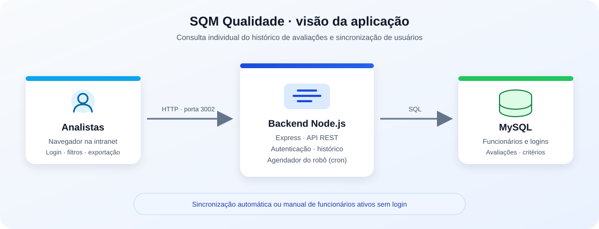

# SQM Qualidade

Aplicação web interna para que analistas consultem o próprio histórico de avaliações de qualidade e acompanhem seus resultados. O sistema combina uma interface web, uma API Node.js/Express e um banco MySQL existente.



## Visão geral

Após autenticar, cada analista consulta apenas os dados associados à sua matrícula. A interface apresenta indicadores e avaliações do período disponível, com detalhamento dos critérios, não conformidades e desclassificações. Os dados podem ser filtrados por data e exportados para uma planilha Excel.

### Recursos

- Autenticação por matrícula e senha, com sessão baseada em token JWT.
- Consulta de avaliações dos últimos seis meses e filtros por período.
- Resumo de resultados e histórico detalhado das avaliações.
- Detalhamento de critérios e desclassificações conforme a avaliação N1 ou N2.
- Exibição de TMA para analistas N1.
- Exportação do histórico filtrado para `.xlsx`.
- Alteração de senha pelo usuário autenticado.
- Sincronização automática de funcionários ativos sem login e execução manual do robô.
- Interface e bibliotecas estáticas servidas localmente, adequada a ambientes sem acesso externo à internet.

## Tecnologias

- **Frontend:** HTML, CSS/Tailwind CSS e JavaScript.
- **Backend:** Node.js, Express e `node-cron`.
- **Banco de dados:** MySQL, conectado por `mysql2`.
- **Exportação:** SheetJS/XLSX.

## Estrutura do projeto

```text
.
├── backend/
│   ├── public/                 # Interface e bibliotecas estáticas
│   ├── scripts/                # Tarefas de build
│   ├── src/
│   │   ├── config/             # Banco de dados e critérios de avaliação
│   │   ├── controllers/        # Autenticação e consultas
│   │   ├── cron/               # Robô de sincronização
│   │   ├── middlewares/        # Autenticação e autorização
│   │   ├── routes/             # Rotas da API
│   │   ├── scripts/            # Execução manual do robô
│   │   └── server.js           # API, arquivos web e agendamento
│   ├── .env.example            # Modelo sem credenciais reais
│   └── package.json
├── database/
│   └── schema.sql              # Estrutura e dados de demonstração
├── docs/
│   └── images/
│       └── arquitetura.svg     # Diagrama da aplicação
├── *.bat                       # Inicialização, firewall e sincronização
└── README.md
```

## Requisitos

- Node.js 18 ou superior e npm.
- MySQL ou MariaDB acessível pelo backend.
- Um banco compatível com as tabelas utilizadas pela aplicação. Em instalações corporativas, use o banco SQM/newSQM aprovado pela equipe responsável.

## Configuração local

1. Clone o repositório e instale as dependências:

   ```powershell
   git clone https://github.com/eltoncelestino/Consulta_Qualidade.git
   cd Consulta_Qualidade\backend
   npm install
   ```

2. Crie `backend/.env` a partir do modelo:

   ```powershell
   Copy-Item .env.example .env
   ```

3. Edite `backend/.env` com os dados do seu ambiente:

   ```env
   PORT=3002
   JWT_SECRET=gere-uma-chave-aleatoria-longa-e-unica

   DB_HOST=localhost
   DB_PORT=3306
   DB_USER=usuario_do_banco
   DB_PASSWORD=senha_do_banco
   DB_NAME=quem

   SYNC_CRON_SCHEDULE=*/10 * * * *
   DEFAULT_USER_PASSWORD=defina-uma-senha-inicial-segura
   ```

   Gere um valor forte para `JWT_SECRET`, por exemplo:

   ```powershell
   node -e "console.log(require('crypto').randomBytes(48).toString('hex'))"
   ```

   Não compartilhe nem versione `backend/.env`. O `.gitignore` exclui esse arquivo.    Configure também uma senha inicial adequada para os logins criados pelo robô e siga a política de credenciais da organização. O backend não inicia sem `JWT_SECRET`, e o robô não sincroniza usuários sem `DEFAULT_USER_PASSWORD`.

4. Gere os arquivos estáticos e inicie o servidor:

   ```powershell
   npm run build:css
   npm start
   ```

5. Acesse `http://localhost:3002/SQD`. O endpoint de verificação da API é `http://localhost:3002/api/health`.

### Banco de dados

O backend espera as tabelas do ambiente SQM/newSQM, incluindo `funcionario`, `login_SQD`, `monitorias` e as tabelas de pontuações e desclassificações correspondentes. Os nomes de algumas colunas são detectados para compatibilidade com diferentes instalações.

`database/schema.sql` é uma referência de estrutura e contém dados fictícios de demonstração; não é um dump da base corporativa. Revise e adapte o esquema à versão do banco antes de usá-lo. **Não execute scripts de demonstração sobre uma base de produção** nem envie dumps de dados para o repositório.

## Robô de sincronização

O robô (`backend/src/cron/syncRobot.js`) procura funcionários com `status = 'YES'` sem registro correspondente em `login_SQD`. Para cada funcionário encontrado, cria um login usando a matrícula como usuário e identificador. A senha inicial vem obrigatoriamente de `DEFAULT_USER_PASSWORD`; o nível gravado atualmente é `1`.

- **Automático:** o backend agenda a execução a cada 10 minutos por padrão, enquanto o processo do servidor estiver ativo.
- **Personalização:** defina `SYNC_CRON_SCHEDULE` no `.env` usando o formato cron aceito por `node-cron`.
- **Manual:** no Prompt ou PowerShell, execute:

  ```powershell
  cd backend
  npm run sync
  ```

  Na raiz do projeto, também é possível executar `sincronizar_usuarios.bat` no Windows. O comando precisa acessar o arquivo `.env` e o banco de dados. O processo automático e o manual são formas alternativas de disparar a sincronização; evite executá-los simultaneamente.

## Publicar na intranet (Windows)

O backend usa a porta TCP **3002** e escuta em todas as interfaces IPv4 da máquina. Para disponibilizá-lo na rede:

1. Instale Node.js e configure `backend/.env` na VM/servidor.
2. Instale as dependências, gere os arquivos estáticos e confirme o acesso local.
3. Execute `liberar_firewall.bat` como Administrador. O script abre a porta da aplicação para a rede interna conforme as regras nele definidas.
4. Inicie o backend com `compartilhar_link.bat` ou `iniciar_sistema.bat` e mantenha-o em execução.
5. Em outro computador da intranet, abra `http://<IP-DA-VM>:3002/SQD` ou `http://<NOME-DA-VM>:3002/SQD`, caso o nome seja resolvido pela rede.

O acesso remoto depende das regras de firewall e da resolução de nomes/IP da rede. Não exponha a aplicação diretamente à internet sem uma análise e configuração apropriadas pela equipe de infraestrutura.

## API

| Método | Rota | Acesso | Descrição |
|---|---|---|---|
| `GET` | `/api/health` | Público | Estado da API |
| `POST` | `/api/auth/login` | Público | Autenticação |
| `GET` | `/api/auth/me` | Autenticado | Dados da sessão |
| `POST` | `/api/auth/change-password` | Autenticado | Alteração da senha |
| `GET` | `/api/monitorias/resumo` | Autenticado | Indicadores do usuário |
| `GET` | `/api/monitorias/historico` | Autenticado | Histórico e detalhes do usuário |

As rotas de monitorias usam a matrícula autenticada para delimitar os resultados. O token deve ser enviado no cabeçalho `Authorization: Bearer <token>`.

## Segurança e dados

- Nunca versione `.env`, senhas, chaves privadas, certificados ou dumps de banco.
- O `.gitignore` exclui esses arquivos e o dump `database/quem.sql`; revise `git status` antes de cada envio.
- Use credenciais próprias e de privilégio mínimo para conectar ao MySQL; evite usar `root` em produção.
- Configure `JWT_SECRET` como um valor aleatório exclusivo e proteja o acesso ao servidor.
- Os dados de demonstração do esquema não são credenciais de produção.
- Arquivos já enviados a um remoto não deixam de estar expostos apenas por serem apagados em um commit posterior. Em caso de exposição, revogue/rotacione as credenciais e chaves afetadas.

## Solução de problemas

- **Erro de conexão com MySQL:** confirme host, porta, usuário, senha, nome do banco e permissões da conta.
- **Login não encontrado:** verifique se a pessoa está ativa em `funcionario` e se já foi sincronizada em `login_SQD`.
- **Interface sem estilos ou exportação indisponível:** execute `npm run build:css` e confira a presença de `backend/public/tailwind.css` e `backend/public/vendor`.
- **Acesso pela intranet falha:** confirme que o backend está em execução, a porta 3002 está liberada e o IP/nome do servidor é acessível.
- **Robô não executa automaticamente:** o processo Node.js precisa permanecer ativo; confira `SYNC_CRON_SCHEDULE` e os logs do backend.
